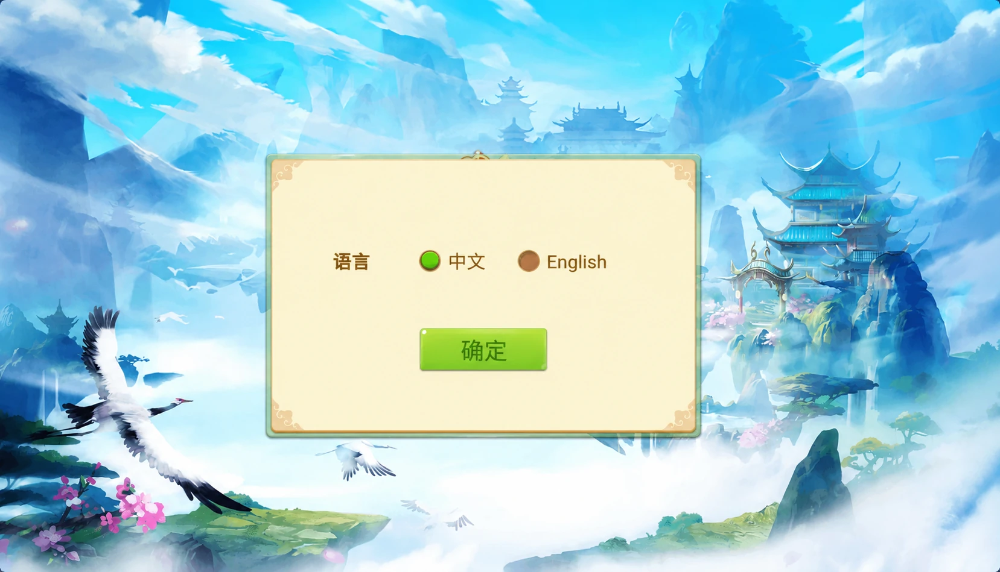

# 洪门H5：多语言界面与文案回退

洪门的大厅采用古风场景，集中展示创建房间、加入房间、玩法、战绩与公告入口。语言设置提供中文与English两个选项。本篇围绕这组界面，介绍H5页面如何组织文案键、切换语言，以及在翻译缺失时保持界面可读。

## 大厅


## 语言选择



配图经过AI编辑，去除了模拟器外框，大厅头像和账号已按展示规则替换。图片用于界面说明，不表示原项目的其他功能已被移除。

## 文案键与回退顺序

按钮的用途应由稳定的文案键表示，例如`createRoom`，显示文字则放入语言字典。这样切换语言时无需修改按钮事件，也不必在业务逻辑中比较中文或英文。

下面是独立编写的JavaScript示例，不是原游戏源码，也不代表该项目实际采用了同样实现。支持的语言只有`zh`与`en`；未知语言回到中文，英文缺失的条目也回到中文，两种语言都没有的键显示方括号占位。

```js
// 独立教学示例，文案键与语言集合均由应用定义。
const messages = {
  zh: {createRoom: '创建房间', joinRoom: '加入房间', rules: '玩法'},
  en: {createRoom: 'Create room', joinRoom: 'Join room'}
};
export function translate(locale, key) {
  if (typeof key !== 'string' || !key) throw new TypeError('需要文案键');
  const language = typeof locale === 'string' && Object.hasOwn(messages, locale)
    ? locale : 'zh';
  const selected = messages[language];
  if (Object.hasOwn(selected, key)) return selected[key];
  if (Object.hasOwn(messages.zh, key)) return messages.zh[key];
  return `[${key}]`;
}
```

`Object.hasOwn`确保只查找字典自身的条目。例如`toString`不会意外匹配对象原型上的方法。界面接收结果时应写入文本节点或框架的默认文本绑定，不应把翻译结果直接当作HTML执行。

## 切换语言时的界面处理

语言选择和确认按钮可以分开：点选语言只改变待确认值，点击确定后再刷新当前界面。保存偏好时只保存允许的语言标识，重新打开页面后仍执行白名单检查。

英文按钮常比中文更宽。布局应给文字留出空间，验证创建房间、加入房间等长标签在窄屏下是否换行或溢出。图片中的中文若直接画在美术资源里，还需要对应语言的资源版本；仅替换文本字典不会改变图片上的文字。

本文只讨论界面文案，不提供房卡交易、负分结算或对局控制实现，也不据此判断原组件的完整实现情况。

## 示例验证

实现见[i18n.mjs](i18n.mjs)，测试见[test.mjs](test.mjs)。使用支持`Object.hasOwn`的Node.js运行：

```sh
node test.mjs
```

9项断言覆盖中英文显示、缺失翻译、未知语言、空语言、未知键、原型属性和空键错误。

## 技术交流

[Telegram @root4433](https://t.me/root4433)
